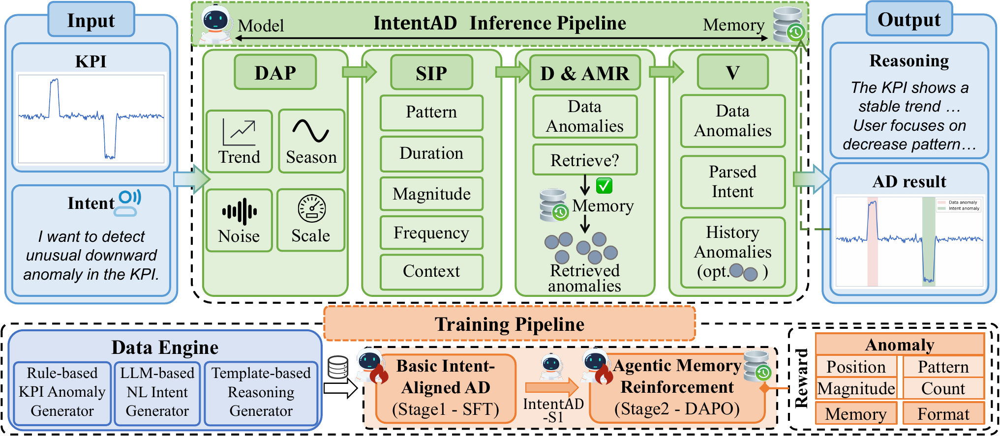

# IntentAD

**Aligning KPI Anomaly Detection with What SREs Want via Intent-KPI Joint Deep Thinking**

This repository provides IntentAD Bench, data-generation and conversion scripts,
and anomaly-detection evaluation code.



## Structure

- `src/ts_generator/`: synthetic time-series, anomaly, and intent-rule generator.
- `src/intentad/generate_intentad_bench.py`: paired train/test benchmark
  generator for IntentAD-style cases.
- `src/generate_tsad_dataset.py`: standalone TSAD JSON generator.
- `src/generate_llm_dataset.py`: TSAD-to-LLM QA JSONL converter.
- `src/convert_uts_dataset_to_tsad.py`: converter for public UTS-style datasets.
- `src/evaluate.py`: original experiment evaluator.
- `scripts/evaluate_single_file.py`: lightweight single-file evaluation wrapper.
- `data/intentad_bench/intentad_bench.jsonl`: the complete IntentAD Bench
  dataset in LLM format.
- `data/intentad_bench/additional_info/intentad_bench.jsonl`:
  per-case intent taxonomy and structured-intent metadata for the same dataset.
- `examples/model_outputs/`: a minimal evaluator smoke-test prediction file.
- `examples/intentad_bench_llm/`: a tiny sample extracted from the complete
  IntentAD Bench file for quick format inspection.
- `DATASETS.md`: data-sharing boundary and rebuild notes.

## Environment

```bash
python -m venv .venv
source .venv/bin/activate
pip install -r requirements.txt
```

Optional LLM-provider dependencies are listed in
`requirements-optional-llm.txt`, but the public scripts do not call external LLM
APIs by default.

## Quick Start

Generate a small synthetic TSAD dataset:

```bash
python src/generate_tsad_dataset.py --num-samples 20 --no-visualize
```

Convert the newest generated TSAD file to LLM QA JSONL:

```bash
DATASET=$(ls -t data/tsad/generated/full/*.json | head -n 1)
python src/generate_llm_dataset.py \
  --input-file "$DATASET" \
  --output-file data/llm_sft/generated/full/QA_demo.jsonl \
  --num-samples 20 \
  --query-memory \
  --include-data-anomalies
```

Generate a paired IntentAD benchmark:

```bash
python src/intentad/generate_intentad_bench.py --num-cases 20 --no-visualize
```

Smoke-test the evaluator:

```bash
python scripts/evaluate_single_file.py \
  --input examples/model_outputs/demo_predictions.jsonl \
  --output results/demo_metrics.json
```

Inspect the complete IntentAD Bench LLM-format data:

```bash
head -n 1 data/intentad_bench/intentad_bench.jsonl
head -n 1 data/intentad_bench/additional_info/intentad_bench.jsonl
```

## Private Data Boundary

The private Service dataset and deployment cases used in the paper contain
confidential KPI names, alert payloads, and business context. They are not
included in this repository. IntentAD Bench uses synthetic metric identifiers
and generic system names, and `additional_info` uses relative dataset paths.
